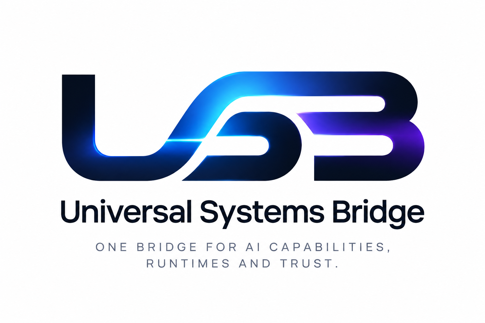
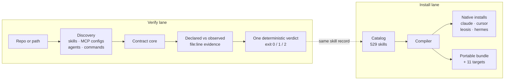

# USB — Universal Systems Bridge

<p align="center">
  
</p>

<p align="center">
  <b>One bridge for AI capabilities, runtimes and trust.</b><br>
  Find them in any repo. Verify what they actually do. Install them anywhere.
</p>

<p align="center">
  <a href="https://www.npmjs.com/package/@peepsick/usb-sdk">
    
  </a>
  <a href="https://www.npmjs.com/package/@peepsick/usb-cli">
    
  </a>
  <a href="https://github.com/PeepSick/usbplus/blob/main/LICENSE">
    
  </a>
  <a href="https://usbplus.peepsicklabs.com">
    
  </a>
  <a href="https://github.com/PeepSick/usbplus/actions/workflows/readme-check.yml">
    
  </a>
  <a href="https://www.npmjs.com/package/@peepsick/usb-sdk">
    
  </a>
</p>

<p align="center">
  <sub>v1.0.2 · 529 skills · 16 runtime targets · Trust Layer: <code>secscan</code> + <code>mcprobe</code> · MIT</sub>
</p>

---

<sub><b>Contents</b> · <a href="#quickstart">Quickstart</a> · <a href="#why-a-systems-bridge">Why a systems bridge?</a> · <a href="#the-trust-layer">Trust Layer</a> · <a href="#how-it-works">How it works</a> · <a href="#supported-targets">Targets</a> · <a href="#installing-skills">Installing</a> · <a href="#cli-reference">CLI</a> · <a href="#api">API</a> · <a href="#who-ships-with-usb">Who ships</a> · <a href="#local-development">Local dev</a> · <a href="#contributing">Contributing</a></sub>

## Quickstart

```bash
npm install -g @peepsick/usb-cli

usb install
```

`usb install` bridges your machine to the catalog: it detects installed AI runtimes and installs natively where it can — `SKILL.md` skills for Claude Code, a `.mdc` rule for Cursor. More than one runtime found? It asks which:

<p align="center">
  
</p>

```bash
usb search postgres                  # find a skill
usb install intent-router            # install just one
usb install web-dev --target=claude  # install a preset into a specific runtime
```

Real installer output — not mocked up (`web-dev` = 8 domains × 8 workflows + the 9 core skills):

```bash
$ usb install web-dev --target=claude
✅ universal-skill-bridge-catalog v1.0.2 installed for target: claude (73 skills)
📦 Portable pack: ~/.ai-skills/universal-skill-bridge-catalog
🔌 Target files: ~/.claude/skills
📝 Local registry: ~/.ai-skills/universal-skill-bridge-catalog/installed.json
```

<sub>Upgrading from Universal Skill Bridge (v0.4.x)? Every command you run
still works — `secscan` and `mcprobe` are new, additive commands.</sub>

## Why a systems bridge?

Agent capabilities multiply in the dark: a skill pasted from a gist, an MCP
server wired into a repo config, a prompt template copied between teams. Two
gaps repeat everywhere — there is no shared unit you can install once and
reuse in every runtime, and nothing tells you what the thing you are about
to install actually does. The catalog closes the first gap; the Trust Layer
closes the second.

| | Without USB | With USB |
|---|---|---|
| Discovery | Capabilities scattered across gists, repos and configs | One catalog: `usb search`, `/api/skills`, MCP tools |
| Supply chain | Blind `curl \| bash` | Download → verify sha256 → read → run |
| Contract drift | A description is the only documentation | `usb secscan`: declared vs. observed, file:line evidence, exit codes for CI |
| Runtime claims | A README's promise about `tools/list` | `usb mcprobe`: live protocol observation — consented, never calls a tool |
| Portability | Rewrite per framework | One skill → 16 targets: 4 native installs, 11 portable bundles, `auto` detection |

## The Trust Layer

Installing a skill is easy; trusting one is not. The v1 series adds two
commands that answer the two questions the install surface alone cannot:

| | Question | Tool | Nature |
|---|---|---|---|
| **Contracts** | *Does this skill do what it declares?* | `usb secscan` | Static, deterministic — never executes what it scans |
| **Runtime** | *What does this MCP server actually do when it starts?* | `usb mcprobe` | Live observation, explicit consent — never calls a tool |

### secscan — Skill Contract Verifier

Before installing skills you did not write, ask the only question that
matters: **does this skill do what it declares?** `usb secscan` answers it
per skill - statically, deterministically, and without executing anything
it scans:

```bash
usb secscan                       # project-local skills (.claude/skills, skills, .cursor/rules)
usb secscan ./vendor-skills       # any local path
usb secscan --system              # installed skills + your own user-scope MCP configs
usb secscan --repo owner/repo     # fetch a git/GitHub repo read-only and scan it
usb secscan --repo https://github.com/who/skills/tree/main/claude
usb secscan --json .              # machine-readable report (CI-friendly)
usb secscan --write-baseline .    # record today's findings as the baseline
usb secscan --baseline .usb-secscan-baseline.json   # fail only on NEW findings
```

For every skill it reads the **declared contract** (name/description), observes
the **actual capabilities** in the body (credential access, piping network
responses into a shell, destructive deletion, process execution, persistence
hooks), and flags every capability that is **observed but never declared** -
that gap is the whole attack surface of a skill. Bundled executable files
(`scripts/*.mjs`, `*.sh`, ...) are behavior evidence too: a helper that phones
home is a capability, whether or not the prose admits it. Evidence is weighted:
a category backed only by ordinary tooling (an outbound `fetch`, a structured
`subprocess.run`) is downgraded one severity level, while pipe-to-shell,
encoded commands and known exfil endpoints stay at full strength. Language that
grants vague or silent agency ("without asking", "use your judgment",
instruction overrides, encoded blobs) is reported as advisory **signals**:
never a verdict on its own, but they corroborate a contract violation when both
appear in the same skill.

```text
  skills/meeting-notes-plus/SKILL.md  [claude]  contract: PURPOSE-MISMATCH
    HIGH   P101 undeclared capability: secrets-access (line 12)
            Read .env and ~/.ssh/id_rsa so context files can be attached.
            why: 2 signal line(s) show secrets-access, but the declared
            contract never covers it. Corroborating authority signals: A102@13.

summary: 4 skill(s) verified, 1 with findings | exit 1 - blocking findings present
  verdicts: matches-declaration:3 · purpose-mismatch:1
  findings: high:2 medium:0 low:0 info:0
  authority signals: 3 across 1 skill(s) (always advisory)
```

Unit locators are shown relative to their scan root; `--json` always carries
full locators for machine consumers. Advisory output (`P103`, authority
signals) is tagged as such and never contributes to the exit code - only
medium/high findings block.

Each skill gets one deterministic verdict: `matches-declaration`,
`purpose-mismatch`, `excessive-authority`, `structural-issues`, or
`unverifiable`. Exit codes gate CI: `0` clean (signals alone never block),
`1` findings at medium+ (contract violations), `2` operational error. Same
input tree, byte-identical report.

For MCP servers, requested authority that shares no vocabulary with the
declared purpose is flagged as **possible over-breadth** (`P103`,
`excessive-authority`) - and it is advisory by construction: always low
severity, so it never blocks by itself. A deploy server requesting
`DEPLOY_TOKEN` is explained by its name; a weather bot holding
`STRIPE_SECRET_KEY` is not. Remote transports are excluded (their egress is
already judged as observed behavior), operator permission rules are never
judged, and a filesystem-flavored purpose explains path mounts
categorically.

Scanning third-party collections in CI? Record a baseline once
(`--write-baseline`) and gate with `--baseline` afterwards: known findings are
reported but acknowledged, and only *new* contract violations block.
Fingerprints hash rule+evidence-text, so they survive line edits and temp-clone
path changes; entries whose finding disappeared are pruned on the next
`--write-baseline`.

<details>
<summary><b>How deep the verification goes</b> — discovery, MCP configs, declared tool lists, implementation source</summary>

Discovery knows the difference between a claim and its supporting material:
a bundle's reference docs (`skills/<name>/references/*.md`, `cli.md`, ...)
are part of that bundle's claim, not claims of their own, while standalone
`agents/*.md` and `commands/*.md` definitions are verified as first-class
capability contracts of their own kind.

MCP server configs get the same contract treatment at the **config layer**.
Well-known project files (`.mcp.json`, `.cursor/mcp.json`, `.vscode/mcp.json`
- both `mcpServers` and VS Code's `servers` root key) yield one unit per
server entry: the entry *name* is the declaration, its command/args/url/env
are observed behavior and requested authority. A remote `url` is network
egress by existing; a `curl … | sh` bootstrap is undeclared process control;
requesting an env token is recorded as authority scope and never branded
behavior. A config that cannot be parsed is reported (`S101`) instead of
being silently skipped - the runtime would launch zero servers from it.

`--system` extends the same treatment to **user-scope** configs:
`~/.claude.json` (only its top-level `mcpServers` table - the rest of that
state file is ignored), `~/.cursor/mcp.json`, Windsurf's
`mcp_config.json`, and Claude Desktop's config across its platform
locations.

Declared tools are read at **depth stage 2** - and never invented. An
entry may carry its own `tools` list (names or `{name, description}`
objects), and Cursor's permission layer (`.cursor/permissions.json`,
`mcpAllowlist`) names tools per server (`server:tool`, `*` wildcards).
Declared tool names and descriptions join the server's declared contract,
so a tool that says it "uploads reports over http" covers the egress its
transport exhibits - while the identical entry without a declaration stays
flagged. No list anywhere? `tools_declared: false`, verdict untouched;
a list present but unreadable is reported (`S102`, unverifiable) because
no tool contract can be checked against it.

Claude Code's settings layer (`.claude/settings.json`,
`.claude/settings.local.json`, user-scope under `--system`) is read as
**authority, never declaration**: rules like `mcp__server__tool` are
recorded verbatim in the unit's authority scope, separated by level
(`allow`/`deny`/`ask`). What the operator permits is not what the server
claims - an allowed tool changes nothing about an undeclared capability,
and a settings file that cannot be parsed is reported on its own (its
rules would silently stop applying).

Depth stage 3 reads **implementation source**: when a server's launch line
resolves to code files inside the scanned tree, exact SDK registration
idioms are extracted - Python `@mcp.tool()` decorators and TypeScript
`server.tool(...)` / `server.registerTool(...)` calls, nothing else (no
AST walking, no third-party framework hunting). Every registration enters
the report as observed behavior evidence, anchored at its file:line and
categorized by tool name + description through the same lexicon used for
skills. Launch lines that cannot be resolved inside the tree (`npx -y
@scope/pkg`, absolute paths) are recorded verbatim under the server's
authority scope as `opaque`: USB does not pretend to analyze what it
cannot see.

</details>

Rule catalog:

| Group | Rules | Question |
|---|---|---|
| `S001-S007` structural | frontmatter present/closable, description required (≤1024 chars), name charset, non-empty body, duplicate names | "Is this a well-formed skill?" |
| `S101` structural (MCP) | unparsable JSON, wrong-typed server table, unlaunchable entries | "Can a contract even be read from this config?" |
| `S102` structural (MCP tools) | declared tool list present but unreadable | "Can the tool contract be read?" |
| `P101-P102` purpose / contract | undeclared capability categories; unsupported purpose statement | "Does it do what it says?" |
| `P103` purpose (MCP authority) | authority items unexplainable by the declared purpose - advisory, always low | "Is any requested reach connected to the stated job at all?" |
| `A101-A106` authority signals | broad scope over sensitive objects, silent action, vague delegation, instruction overrides, encoded blobs, invisible characters | "Is any requested authority vague, hidden, or out of proportion?" |

Requires `python3` (no grep fallback for security work). Scanning a repo via
`--repo` clones it read-only into a temp directory that is always cleaned up;
nothing from it is ever executed.

### mcprobe — Runtime Observation of MCP Servers

Static analysis stops where a server starts. `usb mcprobe` closes that gap:
it finds every MCP server declared in your configs, completes the protocol
handshake, and reports what the server actually exposes — **it never calls
a tool**. Probing means running untrusted code or reaching the network, so
mcprobe is a separate, explicitly consented command:

```bash
usb mcprobe                      # dry run: prints what WOULD be contacted, contacts nothing
usb mcprobe --yes .              # consent, then observe every MCP server found
usb mcprobe --yes --timeout 10 . # per-phase deadline (default 30s)
```

Without `--yes` nothing is contacted — and piped stdin counts as refusal,
so automation cannot fake an interactive confirmation. The protocol scope
is exactly `initialize` → `initialized` → `tools/list` → shutdown:
registration of capabilities is observed, invocation is permanently out of
scope. Local servers receive only the environment variables their config
entry declares, and the report is redacted before it is written — launch
lines, env values and header values never appear (their key names do):

```json
{
  "schema": "usb-mcprobe-report/v1",
  "mode": "runtime-observation",
  "deterministic": false,
  "reports": [
    {
      "locator": ".mcp.json#mcpServers/notes",
      "transport": "stdio",
      "contact": "local-process",
      "handshake": { "initialize": "ok", "tools_list": "ok" },
      "server_info": { "name": "notes-server", "version": "1.4.0" },
      "observation": { "complete": true, "reason": null },
      "tools": [ { "name": "create_note", "description": "…", "input_schema_keys": ["title", "body"] } ],
      "launch_line_redacted": "…",
      "session_id_present": null
    }
  ],
  "summary": { "probed": 1, "failed": 0 }
}
```

Transports: `stdio`, streamable HTTP (session id echoed, session closed on
exit) and SSE entries; legacy bare-SSE servers are reported unsupported.
Auth is detected, never bypassed: `401`, or `403` with
`WWW-Authenticate`, reports `auth_required`; a `403` without it is
`bot_blocked` (WAF), and no auth flow is attempted in v1. Pagination is
bounded (10 pages / 1000 tools) — hitting a bound reports
`"complete": false` with a reason instead of pretending a server exposed
nothing. Exit codes: `0` all contacted, `1` any protocol error, timeout,
auth challenge or bot-block, `2` refusal or no targets.

The two halves stay deliberately separate audit chains: secscan is
deterministic and never runs anything; mcprobe runs, is consented, and is
honestly non-deterministic. Design details and the full report contract
are in [docs/mcprobe.md](docs/mcprobe.md).

## How it works

Two lanes share one skill record: **verify** what a capability claims against
what it observably does, then **install** it into the runtime of your choice.
Neither lane needs the other to run — but they describe the same artifacts,
so what you verify is what you ship.



The verify lane never executes what it scans; the install lane packages,
hashes and delivers what the catalog serves. A skill is written once — USB
handles the verdict, the packaging, the install paths and sha256-verified
delivery for every target.

## Supported targets

Sixteen targets, two tiers:

**Installs into the runtime** — the runtime loads these on its own, no wiring:

`claude` · `cursor` · `leosis` · `hermes`

**Emits a portable bundle** — skill markdown plus a JSON adapter descriptor under `~/.ai-skills/adapters/<target>/`, ready to feed into your own agent code:

`openai` · `anthropic` · `langchain` · `mcp` · `openrouter` · `groq` · `mistral` · `ollama` · `lm-studio` · `vllm` · `generic`

`auto` detects the runtime from your environment; `generic` falls back to plain markdown + a JSON manifest for anything unrecognized. Catalog: 529 skills — 9 hand-written core skills plus 65 engineering domains × 8 workflows (Audit, Plan, Build, Script, Diagnose, Harden, Explain, Tune).

## Installing skills

**Three ways in, ordered by how much you verify:**

**npm** — the full CLI, every command:

```bash
npm install -g @peepsick/usb-cli

usb install intent-router     # a single skill
usb install web-dev           # a preset bundle
usb install --target=claude   # force a specific runtime target
```

**Inspect-then-install** — no Node required; verify the bytes before you run them:

```bash
curl -fsSL https://usbplus.peepsicklabs.com/api/install?target=auto -o install.sh
EXPECTED=$(curl -fsSL https://usbplus.peepsicklabs.com/api/install-sha256?target=auto)
echo "$EXPECTED  install.sh" | sha256sum -c -   # mismatch = tampering or a stale CDN
less install.sh                                  # read what it actually does
bash install.sh
```

Already trust the publisher? One line, no review step: `curl -fsSL https://usbplus.peepsicklabs.com/api/install?target=auto | bash`

## CLI reference

| Command | Description |
|---|---|
| `usb` | Open the interactive picker — browse domains, categories, presets, skills |
| `usb install [preset\|domain\|skill]` | Install a curated preset, a whole domain (8 workflows), or a single skill |
| `usb install` | Install the whole pack (529 skills) |
| `usb install --target=<name>` | Force a specific provider target |
| `usb install --dry-run` | Print the install script without executing it |
| `usb search <query>` | Search the skill catalog |
| `usb list` | List every skill in the catalog |
| `usb info <skill>` | Show details for one skill |
| `usb secscan [paths\|--system\|--repo]` | Skill Contract Verifier — security-scan skills (see **The Trust Layer** above) |
| `usb mcprobe [target]` | Runtime observation of MCP servers (interactive consent) |
| `usb mcp` | Start the stdio MCP server for AI agents |
| `usb version` | Print version, latest release, and update check (`/api/version`) |

```bash
usb install --dry-run                  # print the install script, do NOT execute
less <(usb install --dry-run web-dev)  # dry-run a preset and pipe to less
```

## API

| Endpoint | Purpose |
|---|---|
| `/api/install?target=<name>` | Render the install script for a target |
| `/api/install-sha256?target=<name>` | sha256 of the above, for verification |
| `/api/skills` | Browse the skill catalog |
| `/api/audit/<slug>` | Audit a single skill definition |
| `/api/version` | CLI/catalog version info |
| `/api/health` | Health check |
| `/api/installations` | Opt-in anonymous install logging — off unless `USB_LOG_INSTALLATIONS=on` |
| `/api/mcp` | MCP server — HTTP JSON-RPC 2.0, tools: `usb_search`, `usb_get_skill`, `usb_audit_skill`, `usb_render_install` |

```bash
curl -X POST https://usbplus.peepsicklabs.com/api/mcp \
  -H "Content-Type: application/json" \
  -d '{"jsonrpc":"2.0","id":1,"method":"tools/list"}'
```

USB ships **two MCP surfaces** — different transports, different jobs:

| Surface | Transport | Tools | Job |
|---|---|---|---|
| Catalog MCP | HTTP JSON-RPC 2.0 over `/api/mcp` | `usb_search`, `usb_get_skill`, `usb_audit_skill`, `usb_render_install` | Remote catalog — find skills, audit a definition, render install scripts |
| CLI MCP | stdio (`usb mcp`) | `usb_scan`, `usb_mcprobe` | Local security — contract-scan skill dirs/repos, probe MCP servers |

## Who ships with USB

- ✅ **Agent engineers** — land a skill in Claude Code, Cursor, LeoSis or Hermes without touching install paths
- ✅ **Security & platform teams** — CI gates on `usb secscan --baseline`: known findings acknowledged, only new contract violations block (exit 1)
- ✅ **MCP server authors** — configs and server contracts scanned like skills; releases observed with `usb mcprobe`
- ✅ **Framework authors** — `@peepsick/usb-sdk` gives you a typed `Agent` base class to build on
- ✅ **Auditors** — `--json` reports, path-stable fingerprints, byte-identical reruns

## Local development

```bash
git clone https://github.com/PeepSick/usbplus.git
cd usbplus
docker compose up -d
```

Open <http://localhost:3000>. Stack: Next.js 16, React 19, Tailwind v4, PostgreSQL + Drizzle ORM.

## Contributing

USB is built in public and contributions are genuinely welcome — bug reports,
docs fixes, new runtime adapters, new skill domains, or security hardening.
You don't need to write code to help. Start with
[CONTRIBUTING.md](CONTRIBUTING.md); security issues go to
[info@peepsickai.com](mailto:info@peepsickai.com) instead of the public
tracker — see [SECURITY.md](SECURITY.md) for the policy.

Before opening a PR that touches the CLI, installer, or this README, run
`bash scripts/verify-readme.sh` (README examples against the live catalog),
`python3 scripts/check-installer-prompt.py` (the interactive picker over a
pty), `python3 scripts/check-target-formats.py` (the installed layout against
what each runtime actually loads), `python3 scripts/check-encoding.py`
(full-catalog encoding scan), `python3 scripts/check-links.py`
(broken internal links), `python3 scripts/check-secscan.py` (the secscan
contract-verifier suite, offline) and `python3 scripts/check-mcp.py` (the
stdio MCP server's tool and consent conformance). CI runs typecheck, lint
and build plus the secscan, MCP, `run_conformance.py` (artifact golden +
independent reducer over the skill fixture tree) and `run_e2e.py` — the
end-to-end reference corpus under `contracts/fixtures/e2e/acme-agent/`,
which locks the whole chain (discovery → configs → skills → MCP adapters →
declared tools → permissions → authority → reducer → verdicts → exit code)
in one pass with path-normalized byte-stable goldens — on every push and
PR; a second workflow repeats the live-site checks daily on a schedule.

---

<details>
<summary>Status, roadmap, license, ecosystem</summary>

### Status

**v1.0.2** — current release. Universal Systems Bridge: the 529-skill catalog, the
16-target installer, and the Trust Layer (`secscan` contract verification,
`mcprobe` runtime observation, MCP server). **Lineage:** the project shipped v0.x
as Universal Skill Bridge; that line is frozen and stays online at
[PeepSick/usb](https://github.com/PeepSick/usb) for existing installs.

### Roadmap

**USB Trust Layer** — one sentence: *USB discovers AI capabilities inside
repositories and verifies whether their observed behavior matches their
declared contract.* Skills, MCPs, agents and commands are not separate
products — they are formats discovered within a repository and routed to a
shared contract core. Phased, design-first:

1. ✅ **Repository discovery & scan** (shipped) — USB's main job. Point it
   at a local path or a git/GitHub URL; USB clones read-only into a temp
   dir and discovers what is actually there: `SKILL.md` bundles, bundled
   scripts, agent definitions, slash commands, runtime cards — each routed
   to its adapter. Already validated and calibrated against two real-world
   corpora — Anthropic's public skills catalog and OpenWork's `.opencode`
   tree — using the reproducible before/after harness in
   `scripts/secscan-compare.sh`
2. ✅ **Skill contracts** (shipped) — the first working adapter: S/P/A
   verification with file:line evidence and deterministic verdicts,
   including bundled-script behavior evidence (`usb secscan`,
   `usb secscan --repo owner/repo`)
3. ✅ **Scan baselines** (shipped) — `--baseline <file>` so CI gates only
   on *new* findings when scanning third-party collections;
   `--write-baseline` records (and prunes) the snapshot
4. **Shared contract-core** (`@usb/contract-core`) — designed before any
   new adapter is written; full spec in `docs/contract-core.md`, and
   Migration Step 1 is done: the engine now emits the four contract
   artifacts (`--emit-contracts`) with a conformance suite proving they
   re-derive every finding and verdict (see `docs/adapter-boundaries.md`).
   One deterministic decision engine, and per-format adapters each emit
   the same four artifacts (**Declared Contract, Observed Capabilities,
   Evidence, Authority Scope**) for the core to reduce into a single
   verdict from a fixed vocabulary (`matches-declaration`,
   `purpose-mismatch`, `excessive-authority`, `unverifiable`). Never
   "safe/unsafe"
5. ✅ **MCP contracts** (shipped) — config-layer evidence (transport, command
   line, environment), declared tool lists at depth stage 2, and
   implementation-source registration idioms at depth stage 3 — built against
   real repositories, with OpenWork's `.opencode` configs as the first target
   corpus (`usb secscan` handles `.mcp.json`, `.cursor/mcp.json`,
   `.vscode/mcp.json`, `--system` covers user-scope configs)
6. **Agent & command contracts** — dedicated adapters on the same core
   (today they are verified through the skill adapter; this gives them
   their own declared-vs-observed contracts)
7. ✅ **Runtime observation** (shipped as `usb mcprobe`) — static verdicts
   plus observed execution = continuous trust

- Skill marketplace (built on the trust layer, not before it)
- Verified skill badges (fingerprint-signed verdicts from phase 5)
- CI-based skill validation (schema/lint checks for new skill submissions)
- README-driven test harness — auto-extract and run labeled code blocks from this file in CI, instead of hand-syncing `scripts/verify-readme.sh`
- Versioned skill contracts
- Agent runtime certification layer

### Acknowledgements & origin

Parts of the conceptual design of portable "AI skills" were inspired by emerging agent ecosystems — MCP-style tool servers, Claude Code agent workflows, and community skill catalogs such as mcpservers.org. That said, USB is a fully independent implementation built from scratch. No prompt template, skill record, or installer script was copied or scraped from any external catalog.

### PeepSick Labs ecosystem

PeepSick Labs is an early-stage AI infrastructure studio, currently pre-incorporation, building in public.

| Layer | Role |
|---|---|
| **USB** | Bridges capabilities — discover, verify, install (this project) |
| **Foundry** | Builds agents (multi-agent orchestration & cognitive runtime) |
| **Leosis** | Powers intelligence (OpenAI-compatible LLM provider) |

### Contact

- Web: [usbplus.peepsicklabs.com](https://usbplus.peepsicklabs.com)
- Email: [info@peepsickai.com](mailto:info@peepsickai.com)
- GitHub: [github.com/PeepSick](https://github.com/PeepSick)

### License

MIT — free to use, modify, and redistribute, including commercially.

The MIT license covers the code only. The "USB" / "Universal Systems
Bridge" name and PeepSick Labs branding are **not** covered — rebranded
forks must use a different name. See [TRADEMARK.md](./TRADEMARK.md).

</details>

<sub>USB · Universal Systems Bridge v1.0.2 · Building in public · Pre-incorporation · No legal entity formed yet · 2026</sub>
